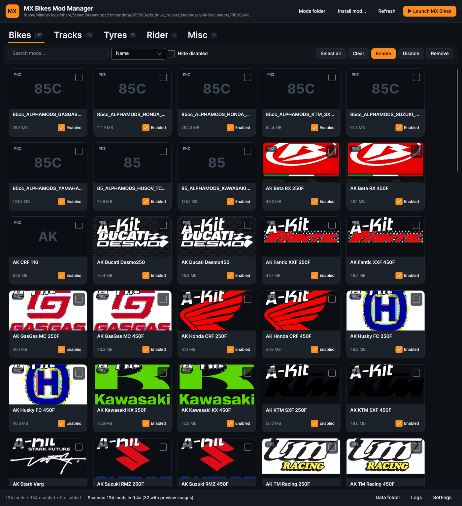

# MX Bikes Mod Manager (Linux)

A native Linux mod manager for [MX Bikes](https://store.steampowered.com/app/655500/) —
built with **Avalonia UI** and **.NET 10**. It reads the game's mods folder directly out of
the Proton prefix, shows every mod as a card grid per type, and enables/disables mods
instantly by renaming them in place.



## Features

- **Tabs per mod type** — Bikes, Tracks, Tyres, Rider, Misc, each shown as a card grid
  (all types and their folders are configurable in `appsettings.json`).
- **Instant enable/disable** — renames `mod.pkz` → `mod.pkz.disabled` (and the paired
  `mod/` asset folder), so nothing is copied and 12+ GB load instantly. State is derived
  from the filename, so manual changes made outside the app stay in sync.
- **Preview images** — cover art inside `.pkz` files is extracted and rendered
  (`capa.tga` for tracks, plus whatever preview image a mod ships), and images found in
  a mod's asset folder are used too. Bike `.pkz` files are usually PiBoSo-obfuscated,
  so tiles without any image fall back to a clean monogram.
- **Category chips** — Bikes are grouped by name rules into A-Kit, 85cc, MX1 250/450,
  MX2 125/250, MX3 300/500, SM1 450, SM2 250, SM Classic, Electric MX/SM and Adventure;
  Rider/Misc get chips from their subfolders (Helmets, Boots, Protections, Riders,
  Animations, Helmet Cams, Fonts…). Chips are ordered by mod count and the **Category**
  sort groups the grid by category, then name.
- **Install mods** — drag & drop anywhere in the window (a full-screen drop hint appears) or pick
  `.zip`, `.7z`, `.rar`, `.tar.gz`, a bare `.pkz` or a folder. Every install opens a
  confirmation dialog showing what was detected, the target path, and the type and
  subfolder — so boots go to `rider/boots`, helmets to `rider/helmets`, etc. Bare `.pkz`
  files are obfuscated, so the type is guessed from the file name and always confirmed.
- **Bike paint jobs** — drop a `.pnt` file or a paint pack and the app detects it, asks
  which bike it belongs to (with a searchable bike picker, pre-filled when the bike name
  is in the file name) and installs it to `bikes/<bike>/paints/`. If the detection is
  wrong you can send it to Bikes, Rider, Tyres, Tracks or Misc instead.
- **Themes** — five dark palettes (Ember, Midnight, Forest, Violet, Mono) under
  **Settings → Theme**. Click a card to preview it live; Save keeps it, Cancel restores
  the previous one. The choice is stored as `ui.theme`, and `--theme <name>` overrides it
  for a single run.
- **Vector icons** — Bootstrap Icons and UIX Icons (both MIT) for mod types, tabs,
  the install-type picker, empty states and toolbar buttons; no emoji, scales cleanly on
  HiDPI screens.
- **Non-destructive** — replaced files are backed up to `data/backups/…`, removed mods go
  to `data/trash/…`, and every operation is logged to `data/logs/app.log`.
- **Search, sort (name/category/size/newest), hide disabled, bulk enable/disable/remove**,
  launch the game, open the mods folder, copy paths.
- **Smooth scrolling** — the mod grid eases mouse-wheel scrolls instead of jumping, with
  native touchpad inertia. Toggle it under **Settings → Smooth scrolling**.
- **Auto-detection** — finds the prefix via `libraryfolders.vdf` across native Steam
  libraries and Flatpak Steam; manual folder picker if that fails.
- **Portable** — config, cache, thumbnails, backups and logs all live inside this repo
  (or next to the AppImage), never in `~/.config`.
- **AppImage build** with `scripts/build-appimage.sh`.

## Requirements

- To build: .NET 10 SDK.
- To run the AppImage: nothing else (self-contained).
- MX Bikes installed through Steam/Proton and started at least once (so the prefix exists).

## Run from source

```bash
dotnet run --project src/MXBikesModManager
```

Headless diagnostics (no window, prints a scan summary):

```bash
dotnet run --project src/MXBikesModManager -- --scan
dotnet run --project src/MXBikesModManager -- --scan --mods "/path/to/…/MX Bikes/mods"
dotnet run --project src/MXBikesModManager -- --theme midnight
dotnet run --project src/MXBikesModManager -- --help
```

## Tests

```bash
dotnet test
```

86 tests cover scanning/pairing, name-based categories, toggling, installs (including
zip-slip attempts, type/subfolder suggestions and confirmation, paint targeting and
backups), themes and icon resolution, smooth-scroll maths, TGA decoding (uncompressed +
RLE), PiBoSo INI metadata, the metadata cache, and Steam/Proton prefix detection.

## Configuration (`appsettings.json`)

Lookup order: `--config <path>` → next to the AppImage/executable → current directory →
repo root. The file is created automatically if it is missing.

```json
{
  "game": {
    "appId": "655500",
    "name": "MX Bikes",
    "modsRoot": "/home/you/.local/share/Steam/steamapps/compatdata/655500/pfx/drive_c/users/steamuser/My Documents/PiBoSo/MX Bikes/mods",
    "launchUri": "steam://rungameid/655500",
    "autoDetect": true
  },
  "data": { "root": "data" },
  "mods": {
    "disabledSuffix": ".disabled",
    "scanDepth": 2,
    "computeSizes": true
  },
  "modTypes": [
    {
      "key": "tracks",
      "folder": "tracks",
      "title": "Tracks",
      "pairedFolder": true,
      "installSubfolder": "Mods",
      "scanSubfolders": [ "Mods", "motocross", "supercross", "supermoto", "enduro" ],
      "categorizeBySubfolder": false
    }
  ],
  "ui": {
    "layout": "grid",
    "tileWidth": 220,
    "tileHeight": 190,
    "showPreviews": true,
    "hideDisabledByDefault": false,
    "smoothScrolling": true,
    "theme": "ember"
  }
}
```

- `ui.theme` — one of `ember`, `midnight`, `forest`, `violet`, `mono`. Unknown values fall
  back to `ember`.
- `ui.smoothScrolling` — eased mouse-wheel scrolling in the mod grid (default `true`).

- `modsRoot` — the game's mods folder inside the Proton prefix. Auto-detected when empty.
- `data.root` — relative paths resolve against the config file's folder, keeping
  everything in the repo (or next to the AppImage).
- `modTypes[].scanSubfolders` — subfolders to scan; `categorizeBySubfolder` turns them
  into filter chips (used for Rider/Misc).
- `modTypes[].icon` — icon key (`bike`, `track`, `tyre`, `rider`, `misc`, `paint`).
- `modTypes[].categoryRules` — ordered regex rules on the mod name for chips (first match
  wins), e.g. `{"name":"MX1 250/450","pattern":"^MX1OEM"}`. `defaultCategory` catches the
  rest; leave it empty to keep them uncategorised.
- `installSubfolder` — where installs go (tracks → `tracks/Mods`).
- `ui.tileWidth/tileHeight` — card size for the grid.

Everything can also be changed in the in-app **Settings** dialog.

## How enabling/disabling works

```
bikes/KTM_450SX.pkz        → bikes/KTM_450SX.pkz.disabled
bikes/KTM_450SX/paints/…   → bikes/KTM_450SX.disabled/paints/…
```

This is a rename on the same filesystem — instant, reversible, and safe for multi-GB
packs. If the game ever turns out to still scan disabled folders, set
`"disableStrategy": "moveToDisabledDir"` (reserved for a future mode) or simply keep the
suffix and remove that folder from `scanSubfolders`.

> Close MX Bikes before toggling many mods; renaming files under a running game can
> confuse its mod cache.

## AppImage

```bash
scripts/build-appimage.sh
# → dist/MXBikesModManager-x86_64.AppImage
```

The script publishes a self-contained `linux-x64` build, assembles an `AppDir` with a
desktop entry and icon, and packages it with `appimagetool` (uses one from `PATH` or
downloads it into `data/tools/`). AppRun forwards arguments, so `--scan` works too.

When running the AppImage, put `appsettings.json` next to the `.AppImage` file (or pass
`--config`) and the app writes its `data/` folder next to it as well.

## Project layout

```
appsettings.json                  portable configuration
src/MXBikesModManager/
  Models/       config + mod entry models
  Services/     SteamLocator, ModScanner, PkzInspector, TgaDecoder,
                ThumbnailService, InstallService, ToggleService,
                MetadataCache, ConfigService, LogService
  ViewModels/   MainWindowViewModel, ModTypeViewModel, ModItemViewModel
  Views/        MainWindow, ModTypeView, Settings/InstallTarget/Message dialogs
  Assets/       icon (svg/png/ico)
tests/MXBikesModManager.Tests/    xUnit test suite
scripts/build-appimage.sh         AppImage packaging
data/                             runtime data (gitignored)
```

## Notes

- `.pkz` files are containers: tracks (and some tyres) are normal ZIPs, so their metadata
  and cover art can be read without extracting anything. Bike packs are obfuscated
  PiBoSo containers — metadata/preview is skipped for those.
- Previews are decoded in-process: TGA (uncompressed + RLE) is handled by a small custom
  decoder, PNG/JPEG/BMP/WebP by Avalonia/Skia.
- Scans only read ZIP central directories and file metadata, so ~200 mods / 13 GB scan in
  well under a second after the metadata cache is warm.
- Icons are from [Bootstrap Icons](https://icons.getbootstrap.com/) 1.11.3 and
  [UIX Icons](https://github.com/mdrakibshekh/uix-icons) (both MIT), embedded as vector
  path geometries in `AppIcons`.
- Drag & drop diagnostics are written to `data/logs/app.log` (formats offered by the
  file manager, dropped item count, and resolved local paths).
- On Wayland sessions the app starts Avalonia's native Wayland backend, which supports
  file drag & drop from native file managers (the XWayland path on Hyprland cannot).
  Set `MXB_FORCE_X11=1` to force the XWayland backend if a compositor misbehaves.
